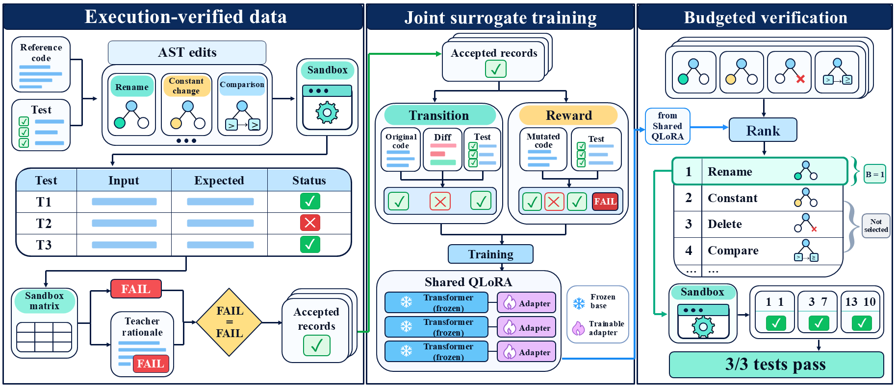

# QuanLLM-World

**Execution-Verified Mutation Surrogates: A Single-GPU World Model for Predicting Code-Test Outcomes**

QuanLLM-World learns from executed Python mutations to predict test behavior and prioritize program verification. A shared Qwen3-14B adapter predicts per-test outcomes and suite verdicts.

## Release status

| Artifact | Location |
| --- | --- |
| Code | [Download the source archive](quanllm_world_code.zip) |
| Data | [Download the research data archive](https://github.com/lct-unv/quanllm-world/releases/download/v0.1.0/quanllm_world_data.zip) |
| Model weights (Hugging Face) | **Coming soon** |

## Overview



1. Apply controlled AST edits to verified Python solutions and execute the original tests.
2. Train a shared adapter on per-test outcomes and suite verdicts. Screen teacher rationales by agreement with the executed verdict.
3. Rank new candidates and spend the verification budget on the highest-ranked programs.

## Results

| Evaluation | Result |
| --- | --- |
| Held-out mutation pools, one execution per problem | 99.1% verified hit rate, versus 25.6% under uniform selection |
| LiveCodeBench, one execution per problem | +7.4 and +4.5 percentage points in verified solve rate over uniform selection across two generators |
| LiveCodeBench, matched JSON decoding | +8.6 and +6.6 percentage points in public-test accuracy over the untuned Qwen3-14B judge |
| Surrogate training | 8 hours on one 24 GB GPU |

## Quick start

Use Python 3.10 or later for archived-result replay. Extract the code and research data archives into the same directory so its `datasets/` and `outputs/` directories are alongside `scripts/`.

```sh
python -m pip install numpy matplotlib pyarrow
python scripts/audit_dev_reports.py
python scripts/rollout_eval.py summarize
python scripts/structured_rollout.py summarize
```

The reproduction guide in the source archive lists the full replay and figure commands, along with dependencies for retraining and fresh inference. Archived-result replay runs on CPU and uses the supplied predictions and test outcomes.

## Data and attribution

The research data archive contains execution annotations, packed training splits, archived predictions, candidate pools, and figure inputs. Its README documents the upstream sources and terms. KodCode-V1 material retains its CC BY-NC 4.0 terms. LiveCodeBench v6 question IDs identify the benchmark tasks used in the archived evaluation.

[KodCode-V1](https://huggingface.co/datasets/KodCode/KodCode-V1) · [LiveCodeBench](https://github.com/LiveCodeBench/LiveCodeBench)
